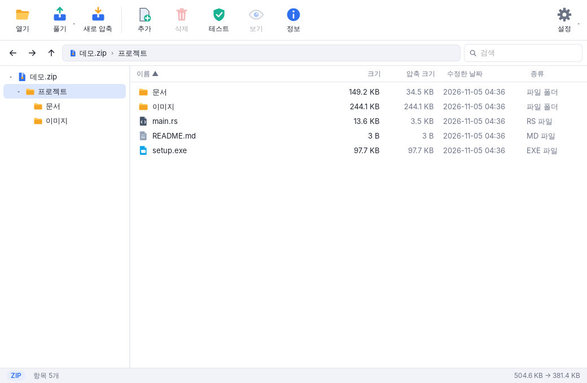
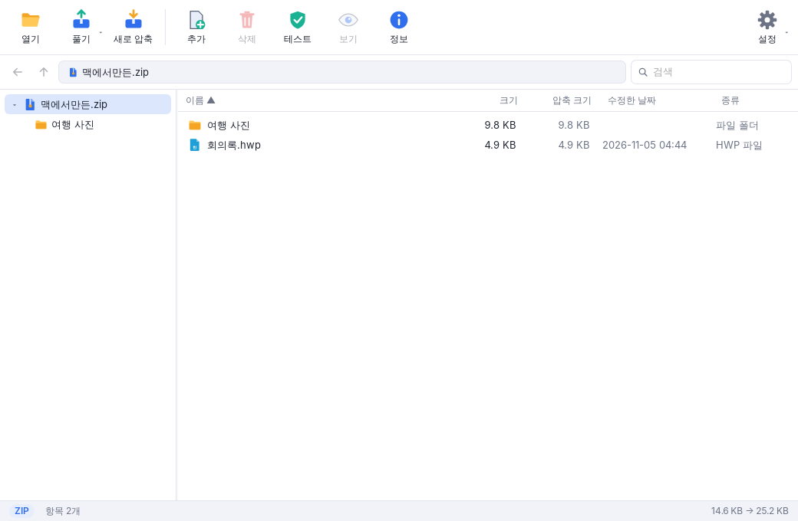
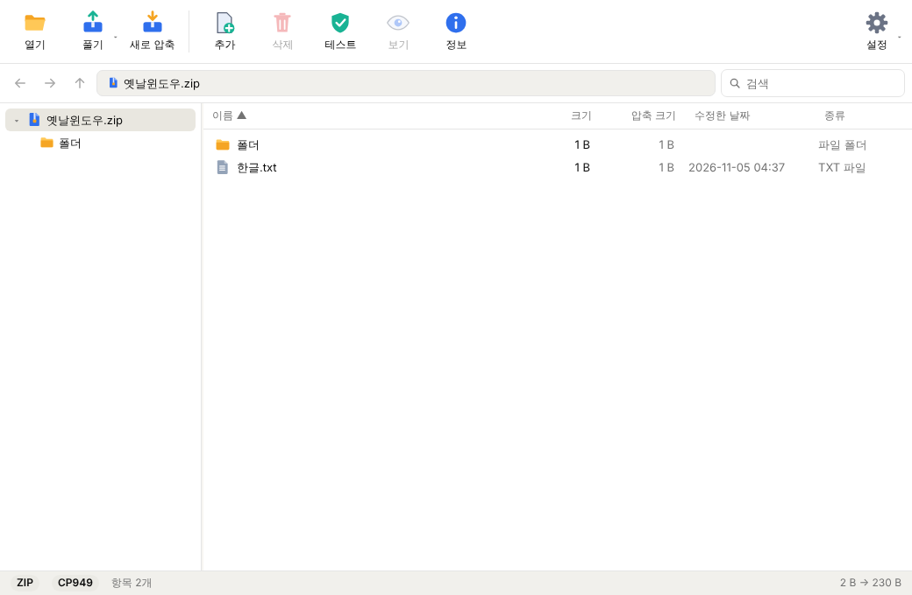

# DaperZip

7-Zip 엔진을 쓰는 압축 프로그램입니다. Windows · macOS · Linux에서 동작합니다.

**다운로드: https://zip.dapercorp.com/**



- 압축 처리는 모두 공식 **7-Zip**이 합니다. 그래서 7-Zip과 같은 형식을 같은 품질로 지원합니다.
- 7-Zip이 프로그램 안에 들어 있어서 따로 설치할 필요가 없고, **인터넷이 없는 환경에서도** 바로 동작합니다.
- MIT 라이선스입니다. 마음대로 쓰고, 고치고, 배포할 수 있습니다.

## 기능

| | |
|---|---|
| **열기 / 미리보기** | ZIP, 7Z, RAR, TAR, GZ, BZ2, XZ, ZST, ISO, CAB, WIM, LZH, ARJ, DMG 등 7-Zip이 읽는 모든 형식을 지원합니다. 폴더 트리와 파일 목록으로 내용을 보여 주고, 수십만 개 항목도 가상 스크롤로 가볍게 표시합니다. |
| **스마트 풀기** | 최상위 항목이 하나면 그 자리에 풀고, 여러 개면 압축 파일 이름의 폴더를 만들어 풉니다. 폴더 이름이 겹치면 자동으로 `이름 (2)`를 만듭니다. |
| **압축** | ZIP, 7Z, TAR, TAR.GZ, TAR.BZ2, TAR.XZ, WIM 형식을 만들 수 있습니다. 압축 레벨, 분할 압축, 비밀번호(ZIP AES-256, 7Z 파일 이름 암호화)를 고를 수 있습니다. |
| **압축 파일 편집** | 파일 추가(지금 보고 있는 폴더 안으로), 삭제, 이름 바꾸기를 할 수 있습니다. 압축 파일 안의 파일을 열어 고치면 "압축 파일에도 반영할까요?"라고 물어봅니다. |
| **끌어다 놓기** | 탐색기에서 끌어 놓으면 열거나 압축하고, 압축 파일이 열려 있으면 그 안에 추가합니다. 목록에서 탐색기로 끌어내 바로 풀 수도 있습니다. |
| **탐색** | 뒤로/앞으로/상위 폴더 이동, 마우스 옆 버튼(이전/다음), `Alt+←/→`, `Backspace`를 지원합니다. |
| **선택과 복사** | 빈 곳에서 끌어 여러 파일을 고르고(드래그 선택), `Ctrl+C`로 복사해 탐색기에서 `Ctrl+V`하면 고른 항목만 풀립니다. 탐색기에서 복사한 파일을 `Ctrl+V`하면 압축 파일에 추가합니다. |
| **업데이트** | 인터넷에 연결되어 있으면 시작할 때 새 버전을 확인하고 업데이트할지 묻습니다(설정에서 끌 수 있음). Windows에서는 설치 파일을 받아 바로 실행합니다. |
| **언어** | 시스템 언어 / 한국어 / English. 바꾸면 바로 적용됩니다. |
| **기타** | 검사(테스트), 압축 파일 정보, 비밀번호 자동 재질문, 작업 취소, 다크 모드, 한국어/영어를 지원합니다. |
| **탐색기 통합 (Windows)** | 오른쪽 클릭 메뉴에 *DaperZip으로 압축 풀기 ▸ 여기에 풀기(스마트) / 여기에 풀기 / 폴더에 풀기 / 다른 폴더에…*와 *DaperZip으로 압축하기 ▸ ZIP / 7Z / 압축하기…*를 추가하고, "연결 프로그램"에 자동으로 등록합니다. 기본 앱은 설치 완료 화면의 **기본 앱으로 설정**에서 한 번만 고르면 됩니다. 여러 파일을 고르면 하나의 작업으로 모아서 처리합니다. |

### 파일 이름 깨짐 방지 (Mac ↔ Windows)

| 문제 | DaperZip의 처리 |
|---|---|
| Mac에서 만든 압축 파일의 한글 이름이 Windows에서 `ㅎㅏㄴㄱㅡㄹ`처럼 자모가 분리되어 보임 (NFD) | 목록에 정상 한글(NFC)로 표시하고, 풀 때 파일 이름도 NFC로 바꿉니다. |
| Mac에서 압축하면 Windows 사용자가 받았을 때 이름이 깨짐 | 압축할 때 이름을 NFC로 저장합니다. |
| 옛 Windows 도구로 만든 ZIP(CP949)의 한글이 Mac/Linux에서 `����`로 보임 | 이름 인코딩을 자동으로 감지합니다. Windows에서는 7-Zip `-mcp`로 바로 처리하고, Mac/Linux에서는 이름만 UTF-8로 바꾼 임시 사본을 만들어 읽습니다(압축 데이터는 그대로 복사). |
| `__MACOSX`, `.DS_Store`, `._파일` 같은 쓰레기 파일 | 목록에서 숨기고, 풀 때와 압축할 때 제외합니다. |

이 동작은 모두 **설정 → 파일 이름 (Mac 호환)** 에서 끌 수 있습니다.

<p>


</p>

## 설치

[Releases](../../releases)에서 운영체제에 맞는 파일을 받으세요.

- **Windows**: `DaperZip_x.y.z_x64-setup.exe` (설치형, 관리자 권한 불필요) 또는 `DaperZip-portable-windows-x64.zip` (압축만 풀면 바로 실행)
- **macOS**: `DaperZip_x.y.z_universal.dmg` (Apple Silicon과 Intel 모두 지원)
  - 아직 Apple 공증을 받지 않은 빌드라서 처음 실행할 때 경고가 나옵니다. macOS 14 이하는 **Finder에서 오른쪽 클릭 → 열기**, macOS 15 이상은 **시스템 설정 → 개인정보 보호 및 보안 → "확인 없이 열기"**를 이용하세요.
  - 터미널에서 `xattr -dr com.apple.quarantine /Applications/DaperZip.app`을 실행해도 됩니다.
- **Linux**: `.AppImage` 또는 `.deb`

Windows 설치 프로그램에서 **나만 사용**(관리자 권한 불필요) 또는 **모든 사용자**(관리자 권한 필요) 중에 고를 수 있습니다.
설치하면 탐색기 오른쪽 클릭 메뉴가 자동으로 추가됩니다(설정에서 끌 수 있음).
Windows 11에서는 메뉴가 *추가 옵션 표시* 안에 나타납니다.

### 터미널 설치

- **Windows**: `winget install DaperCorp.DaperZip` (winget-pkgs 등록 검토 중)
- **macOS · Linux**: 릴리스의 `SHA256SUMS`로 검증하는 설치 스크립트

  ```sh
  curl -fsSL https://zip.dapercorp.com/install.sh | sh
  ```

  curl로 받으면 macOS 격리 표시가 붙지 않아 첫 실행 경고 없이 실행됩니다.
  그래도 경고가 나오면 `--no-quarantine`을 명시하세요.

  ```sh
  curl -fsSL https://zip.dapercorp.com/install.sh | sh -s -- --no-quarantine
  ```

## 직접 빌드하기

필요한 것: [Rust](https://rustup.rs), Node.js 18 이상(Tauri CLI 실행용), [Tauri 사전 요구 사항](https://tauri.app/start/prerequisites/)

공식 7-Zip 26.04 실행 파일이 `vendor/7zip/`에 들어 있어서(Windows/macOS/Linux, 약 12MB)
**인터넷 연결 없이** 빌드할 수 있습니다. 7-Zip을 새 버전으로 바꿀 때만 `scripts/update-7zip.sh <버전>`을 실행하세요.

```bash
cargo test -p daperzip-core
```

엔진 테스트입니다. 실제 7-Zip을 사용합니다.

```bash
cd app && npx @tauri-apps/cli@2 build
```

설치 파일과 앱 번들을 만듭니다. 결과물은 `target/release/bundle/`에 생깁니다.

`main` 브랜치에 push하면 GitHub Actions가 세 운영체제용 빌드를 모두 만듭니다.

### 앱 아이콘

앱 아이콘의 원본은 `app/icons/source/`의 SVG입니다. 큰 크기용(`app-icon.svg`)과 16/24/32px용으로 픽셀을 맞춘 버전이
따로 있습니다. 원본을 고친 뒤 `node scripts/build-icons.mjs`를 실행하면 앱(`app/icons/`), 웹사이트 파비콘,
설치 프로그램 로고가 모두 다시 만들어집니다(ImageMagick 7 필요). 회사 로고(`daper-mark.png`)와는 별개의 파일입니다.

### 릴리스

```bash
scripts/bump-version.sh 0.1.1
```

버전을 올리고 `release-notes/v0.1.1.md`를 만듭니다. 릴리스 노트를 쓰고 `main`에 push하면,
세 운영체제 빌드가 통과한 뒤 CI가 `v0.1.1` 태그와 릴리스를 자동으로 만들고 설치 파일을 첨부합니다
(1.0.0 미만은 pre-release). 자세한 내용은 [release-notes/README.md](release-notes/README.md)를 보세요.

## 구조

```
crates/daperzip-core/   7-Zip 래퍼(Rust): 목록 파싱, 풀기/압축/삭제/이름 바꾸기/검사,
                      진행률, 취소, 비밀번호, 스마트 풀기, 파일 이름 정규화, 레거시 ZIP 변환
app/                  Tauri 앱: 창 관리, 백그라운드 작업, 명령줄(탐색기 메뉴),
                      단일 인스턴스, Windows 레지스트리 통합, 설정
ui/                   화면(HTML/CSS/JS, 빌드 도구 없음)
vendor/7zip/           내장된 공식 7-Zip 실행 파일 (Windows/macOS/Linux)
scripts/              7-Zip 버전 업데이트, 버전 올리기, 웹사이트·아이콘 생성
```

DaperZip은 압축 알고리즘을 직접 구현하지 않습니다. 모든 작업은 별도 프로세스로 실행되는
7-Zip 명령줄 프로그램(`7z`/`7zz`)이 처리합니다. 덕분에 7-Zip을 새 버전으로 바꾸기만 하면 엔진이 업데이트됩니다.

## 라이선스

- DaperZip 코드: [MIT](LICENSE)
- 7-Zip: GNU LGPL + unRAR 제한. 자세한 내용은 [THIRD_PARTY_NOTICES.md](THIRD_PARTY_NOTICES.md)를 보세요.

DaperZip은 독립 프로젝트이며 7-Zip이나 다른 압축 프로그램 제작사와 관계가 없습니다.
